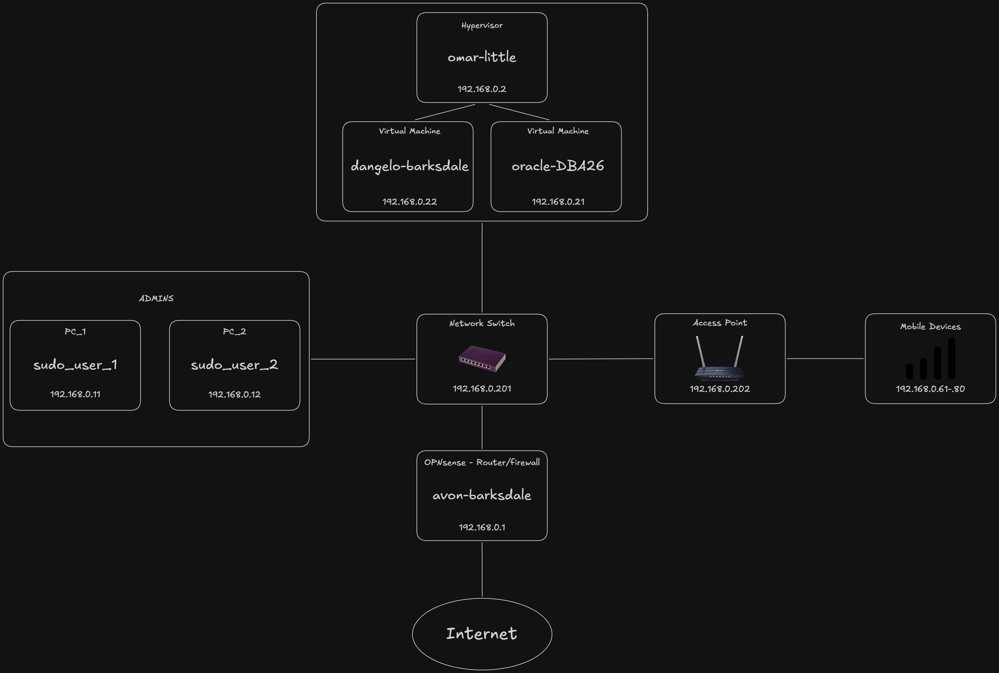
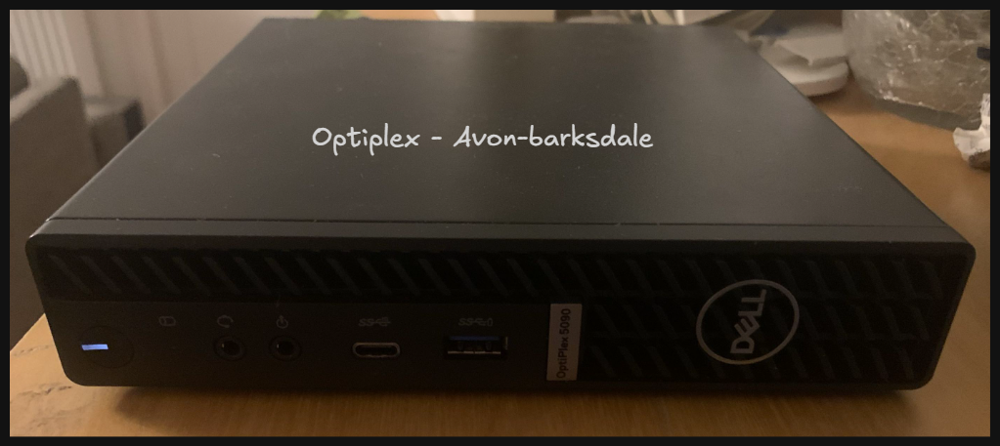
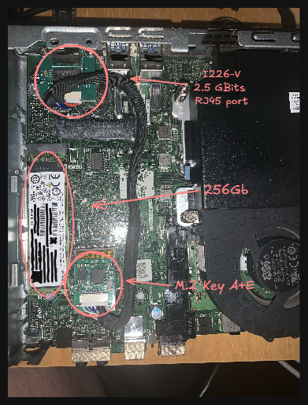
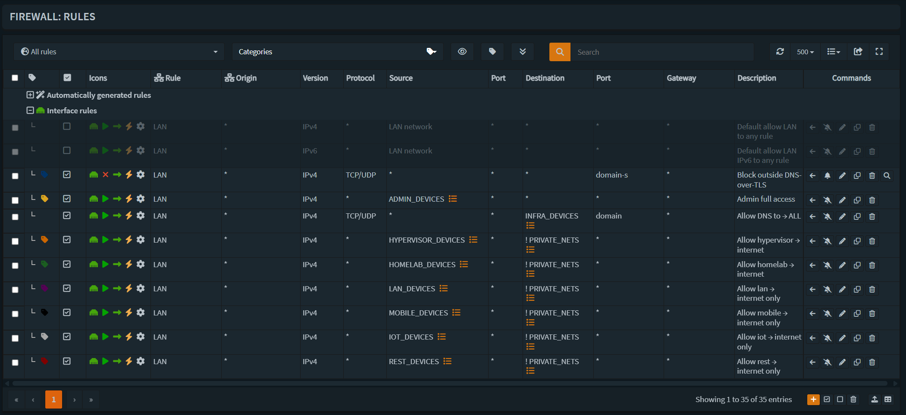
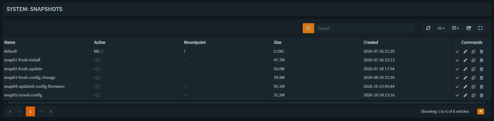
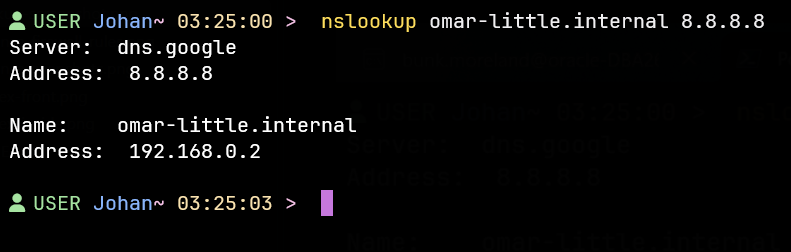

# avon-barksdale — OPNsense firewall

Firewall and router for my home lab: design, reasoning and a sanitized copy of the running configuration.

**In short:** a bare-metal OPNsense firewall running in production at home. It shows default-deny firewalling with least-privilege device groups, hardened DNS (DNSSEC, DNS-over-TLS, forced local resolver), remote logging, ZFS rollback, a documented troubleshooting case and a planned migration to VLANs and 802.1X.

> **Work in progress:** this is a living setup, not a finished one. The configuration and this README change as I keep learning; see the [Changelog](#changelog) for what changed and when. Suggestions, improvements and spotted mistakes are very welcome. Open an [issue](../../issues) and I'll take a look.

> **Sanitized:** the [config export](config/config-avon-barksdale-sanitized.xml) has private keys, certificates, password hashes, SSH keys, MAC addresses and the SSH port replaced with `REDACTED`; usernames are replaced with placeholders. Device hostnames are kept on purpose. No public IP addresses are published.

---

## How this was built

I designed and configured this myself, with an LLM as a sounding board for tuning and reviewing settings.

- **My own work:** the firewall rules and device groups, DNS-over-TLS upstream, and DNSSEC validation in Unbound.
- **Built with LLM help:** remote logging (rsyslog, log rotation), forced local DNS (the NAT redirect and the DNS-over-TLS block), and the remaining Unbound tuning. These were gaps in my knowledge; I understand what they do and am still reading up on the details.

---

## Hardware

| Part | Choice | Why |
|---|---|---|
| Chassis | Dell OptiPlex 5090 Micro | Quiet, compact, second-hand |
| CPU | Intel i5-10500T | Low-power "T" variant; routing and filtering don't need a desktop chip |
| RAM | 16 GB | Headroom for IDS/IPS rule sets during testing |
| Storage | 256 GB M.2 SSD, ZFS | Room for logs and rule sets; snapshots before changes |
| WAN NIC | Onboard Intel I219-LM, 1 Gbit | Stable FreeBSD driver |
| LAN NIC | Intel I226-V, 2.5 Gbit, on an M.2 A+E (Key E) adapter | See below |

### The second network port

The OptiPlex has one network port, and a firewall needs two. The Wi-Fi slot is M.2 Key E, which carries PCIe underneath. A 2.5 Gbit card needs a single PCIe lane, so an I226-V on an M.2 A+E adapter fits, with a cable to an RJ45 port mounted in the case.

---

## Design principles

- **Deny by default.** The built-in "allow LAN to anything" rules are disabled; every allowed flow is an explicit rule.
- **Least privilege.** Each device group gets only what it needs.
- **Log what is blocked, not what is allowed.** The default deny logs every drop; allow rules don't log, which keeps the logs readable.
- **No unused doors.** IPv6 is disabled globally (Interfaces → Settings), no interface has an IPv6 address, and the default IPv6 allow rule is off. The network runs on IPv4 only, so an unused protocol is removed rather than secured.
- **Built for the next step.** Every group maps to a planned VLAN, so the move to VLANs is a migration, not a redesign.
- **Designed to grow into enterprise patterns.** VLANs, 802.1X and RADIUS are planned (see Roadmap), on hardware that fits a home.

---

## Device groups

| Group | Today (192.168.0.x) | Planned VLAN | Planned subnet | Role |
|---|---|---|---|---|
| INFRA | .1 | 10 | 10.0.10.0/24 | Firewall |
| NETWORK | .201–.250 | 10 | (joins INFRA) | Switches and access points |
| HYPERVISOR | .2–.10 | 20 | 10.0.20.0/24 | Proxmox hosts |
| ADMIN | .11–.20 | 30 | 10.0.30.0/24 | Admin devices |
| HOMELAB | .21–.40 | 40 | 10.0.40.0/24 | Lab VMs and services |
| LAN | .41–.60 | 50 | 10.0.50.0/24 | Everyday computers |
| MOBILE | .61–.80 | 60 | 10.0.60.0/24 | Phones and tablets |
| IOT | .81–.100 | 70 | 10.0.70.0/24 | Smart devices |
| REST | .101–.200 | 80 | 10.0.80.0/24 | Unknown devices |

In the planned addressing, the third octet matches the VLAN ID. Inside each VLAN: `.1` is the firewall, `.2–.99` reservations, `.100–.200` the DHCP pool. VLAN 1 stays unused; `10.99.0.0/24` is reserved for VPN clients.

---

## Firewall rules

An allow list on top of default deny. About 60 explicit block rules were replaced by 8 allow rules, with the same effect and less to maintain, plus one block rule that applies to every group.

| # | Source | Destination | Action |
|---|---|---|---|
| 1 | any | any, DNS-over-TLS (853) | block, logged |
| 2 | ADMIN | any | allow |
| 3 | any | INFRA, DNS only (TCP/UDP 53) | allow |
| 4–9 | HYPERVISOR, HOMELAB, LAN, MOBILE, IOT, REST (one rule each) | internet only (`! PRIVATE_NETS`) | allow |
| – | everything else | – | default deny, logged |

- `PRIVATE_NETS` holds every non-internet range: RFC 1918, `100.64.0.0/10` (carrier-grade NAT) and `169.254.0.0/16` (link-local).
- NETWORK has no allow rule: switches and access points need no internet access, and the ADMIN rule covers management.
- **WAN:** no allow rules. Private and bogon networks are blocked. The WAN has a public, dynamic IPv4 address; nothing is reachable from the internet.
- **Scope today:** on a flat network, rules apply to traffic that passes the firewall (to the firewall itself and to the internet). Traffic between groups only passes the firewall once groups are on separate VLANs. Isolation *within* a group needs client isolation on the access point or port isolation on the switch.

---

## DNS (Unbound)

- DNSSEC validation; identity and version hidden; aggressive NSEC, prefetching, serve-expired.
- Upstream over **DNS-over-TLS** to Quad9 (two servers). No plain-text upstream DNS.
- Ad and tracker blocklist, refreshed by a scheduled job.
- **Forced local DNS:** a NAT rule redirects any plain DNS (port 53) from LAN to the firewall, so devices with hardcoded resolvers still get filtered, validated answers. Outbound DNS-over-TLS (853) from LAN is blocked, so devices fall back to the local resolver.
- **Internal names** (`*.internal`) through host overrides; clients and SSH configs use names, not addresses.

---

## Addressing

- Static addresses for infrastructure, outside the DHCP pool: firewall `.1`, Proxmox `.2`.
- DHCP (Kea) reservations for known devices in their group's range: admin devices, lab VMs (`.21`, `.22`), switch and access point (`.201`, `.202`).

---

## Management and logging

- Web GUI over HTTPS, LAN only, 15-minute session timeout.
- Shell sessions (SSH and console) log out after 15 minutes of inactivity; the console menu is password protected, and sudo asks for a password.
- GUI logins restricted to the ADMIN range through the admin group's source networks.
- Root disabled; each admin has a named personal account.
- SSH: LAN and admin group only, non-default port, **key-only** (one key per person, generated on their own machine).
- Failed logins are blocked by OPNsense's built-in login protection.
- Anti-lockout is enabled deliberately, so the GUI and SSH each remain a way back in if the other fails.
- **Remote logging (temporary):** firewall logs go over syslog (UDP) to a lab VM, received by rsyslog into a dedicated file, rotated daily or at 100 MB, compressed and kept for 14 days. On the VM, firewalld accepts syslog only from the firewall's address. Its purpose is the freeze investigation (see Troubleshooting): a frozen firewall can't keep its own logs, so they're kept off the box.
- Traffic shaping: fq_codel on WAN (download and upload), set just below the line rate to prevent bufferbloat.
- SYN cookies in adaptive mode: enabled when the state table reaches 25 % and disabled below 12 %, protecting the state table against SYN floods once services are exposed.

---

## IDS/IPS (Suricata)

Rule sets are split by confidence:

| Policy | Action | Rule sets |
|---|---|---|
| Confirmed malicious (low false positives) | Drop | abuse.ch (Feodo Tracker, SSL Blacklist, SSL IP Blacklist, ThreatFox, URLhaus), botnet C2, `drop`, ThreatView Cobalt Strike C2, emerging-exploit, exploit_kit, netbios, phishing, remote_access, rpc, shellcode, telnet, tftp, worm |
| Behavioral / broad | Alert only | emerging-scan, malware, mobile_malware, coinminer, icmp, snmp, abused services, user_agents, tor |

**Status: off, by decision.** Inline mode (netmap) froze the firewall on this hardware (see Troubleshooting). Inline IPS also sits in the traffic path, and the added latency was noticeable in online gaming; alert-only IDS only observes a copy of the traffic, so it doesn't add that delay. Most traffic is encrypted anyway, which limits what IDS/IPS can see. IDS/IPS stays off for daily use; it is only turned on during planned tests to find the cause of the freezes. High-confidence threat lists can move to firewall aliases, which block without inline inspection or added latency.

---

## Snapshots

OPNsense runs on ZFS; a snapshot is taken before every larger change, so a failed update or config change rolls back in minutes.

| Snapshot | When |
|---|---|
| snap01-fresh-install | After installation |
| snap02-fresh-update | After the first firmware update |
| snap03-fresh-config-change | After the first large rule change |
| snap04-updated-config-firmware | Before publishing this repo |

Snapshots share the disk, so they protect against configuration mistakes, not disk failure.

---

## Troubleshooting

### Firewall freezing every 12–24 hours

- **Symptom:** after moving OPNsense from a Proxmox VM to bare metal, the firewall froze completely every 12–24 hours: no GUI, no SSH, no response on the LAN, and no log entries at the moment of failure. Only a hard reboot recovered it.
- **First suspect:** the I226-V, which FreeBSD drives directly on bare metal.
- **Isolation:** two things had changed at once: the move to bare metal, and Suricata running inline (netmap) on WAN. I disabled Suricata and changed nothing else.
- **Result:** the freezes stopped and the firewall has been stable on bare metal since. The trigger was inline IPS, not the network card. A total freeze with nothing logged fits a kernel-level (netmap) problem rather than a service crash.
- **Lesson:** change one thing at a time.
- **Status: open.** The trigger is known; the root cause isn't. Because the whole system hangs, nothing reaches the local logs, which is why logs are now sent to a lab VM over syslog.
- **Limit of remote logging:** if the kernel itself hangs, it can't send syslog either, so remote logs show the lead-up but probably not the moment of failure.
- **Next steps** (kernel debugging is new to me, so this is also a learning goal):
  - **Kernel crash dump** (`dumpdev`): if the hang ends in a panic, the kernel's state is saved to disk for analysis after reboot.
  - **Console output:** a monitor on the VGA console (or a serial console) during tests, to see the last messages before a hang.
  - **Hardware watchdog:** reboots the firewall automatically instead of leaving it frozen.
  - **One variable per test:** run inline Suricata during planned test windows, then change one thing at a time (netmap on LAN instead of WAN, fewer rule sets, a different NIC driver setting). IDS/IPS is turned off again after each test.

### DHCP reservation not applied

- **Symptom:** a VM kept its old address despite a new reservation.
- **Diagnosis:** the Kea log showed a conflict: another device (a phone with a randomized MAC) held a lease on the reserved address.
- **Fix:** deleted that lease, reconnected the phone, renewed the VM.

---

## Planned: 802.1X

Goal: a device's identity, not the port it uses, decides its VLAN.

| Part | Role | In this setup |
|---|---|---|
| Supplicant | Device that authenticates | PCs and phones (certificates, EAP-TLS) |
| Authenticator | Switch or access point that holds the port closed | 802.1X-capable switches and access point |
| Authentication server | Checks identity, returns a VLAN | FreeRADIUS on a Raspberry Pi |

Devices without 802.1X support (TVs, smart plugs) are placed by MAC address (MAB); the DHCP reservations are the start of that inventory. VLANs come first with ports assigned by hand on the current switch, which supports 802.1Q but not 802.1X; identity checks are added on top without redesigning the VLANs.

---

## Verification

Tests that show the configuration works as described.

### Forced local DNS

A query sent directly to Google's resolver (8.8.8.8) for an internal name that only the firewall knows:

Google can't resolve `*.internal`, so the answer `192.168.0.2` proves the NAT rule intercepted the query and the firewall answered it. nslookup still shows `dns.google` as the server, because the redirect is invisible to the client.

---

## Known limitations

- **Flat network.** All groups share one /24, so rules don't apply between devices on the same switch.
- **IP-based groups.** The DHCP pool spans several group ranges, and a device with a self-assigned address in the ADMIN range gets admin access. VLANs and 802.1X address both.
- **No 2FA on the web GUI.** OPNsense's TOTP takes the code and the password in a single field (the 6-digit code followed by the password), which is counter-intuitive and led to repeated lockouts. It stays off until there is a separate prompt for the code; compensated with a long, unique password. Planned replacement: hardware keys (FIDO2) for SSH, with GUI access through an SSH tunnel.
- **Anti-lockout** lets every LAN device reach the GUI and SSH ports; only the admin range can log in. To be disabled once admin devices have their own VLAN.
- **DNS-over-HTTPS bypass.** Plain DNS is redirected and DNS-over-TLS is blocked, but DNS-over-HTTPS shares port 443 with normal web traffic and can't be blocked by port.
- **Config backups are manual:** encrypted exports stored off-site after larger changes; no automated backup yet.
- **Randomized MAC addresses** on phones break MAC-based reservations and, later, MAB.
- **Wi-Fi is one group:** the current access point can't map SSIDs to VLANs.
- **Syslog over UDP is unencrypted** and can drop messages. It's a temporary setup for the freeze investigation on a single LAN; TLS syslog is an option if it stays.
- **Proxmox management is reachable from the whole LAN** on a flat network; only its own login protects it until the HYPERVISOR VLAN exists.
- **The switch's admin page is HTTP only,** so its password crosses the LAN unencrypted. Management moves to the admin VLAN with the VLAN migration.

---

## Roadmap

1. Automated off-box config backups.
2. Reservations for remaining devices; DHCP pool limited to the REST range.
3. VLANs on the current switch, one group at a time; then disable anti-lockout.
4. 802.1X switches and a WPA2/WPA3-Enterprise access point with client isolation; FreeRADIUS on a Raspberry Pi.
5. FIDO2 hardware keys for SSH.
6. Finish the freeze investigation with inline IPS in test windows; threat lists as firewall aliases for daily blocking.
7. WireGuard for remote access, on its own subnet.
8. 5G backup line (multi-WAN).

---

## Changelog

| Date | Change |
|---|---|
| 2026-10-25 | Verification section (forced DNS proven with an internal-name lookup via 8.8.8.8); IPv6 disabled globally; work-in-progress note; 15-minute GUI session timeout and shell inactivity timeout; IPv6 removed from interfaces; kernel debugging plan for the freeze investigation; network diagram; config re-exported and re-sanitized; README summary, rule screenshot and new known limitations; log rotation capped at 100 MB; IDS/IPS off for daily use (latency); freeze investigation opened; "How this was built" section |
| 2026-10-24 | 8 allow rules on default deny; completed `PRIVATE_NETS`; public IP from the ISP (CGNAT removed); forced local DNS and outbound DNS-over-TLS blocked; SYN cookies (adaptive); SSH key-only; GUI logins limited to the ADMIN range; remote logging to a lab VM; Proxmox on a static address; reservations for lab VMs, switch and access point; NETWORK group; internal DNS names and role-based hostnames for admin devices (`admin-pc-01/02`); troubleshooting corrected (inline Suricata, not the I226-V); DHCP troubleshooting documented; README rewritten |
| 2026-10-23 | Hardware photos and sanitized config export |
| 2026-10-13 | Repository created |