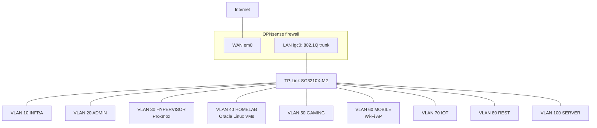
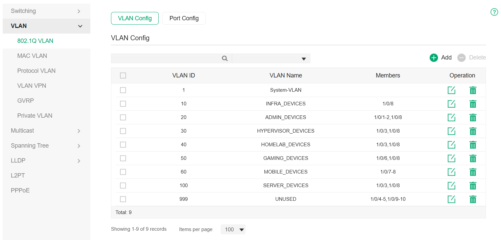
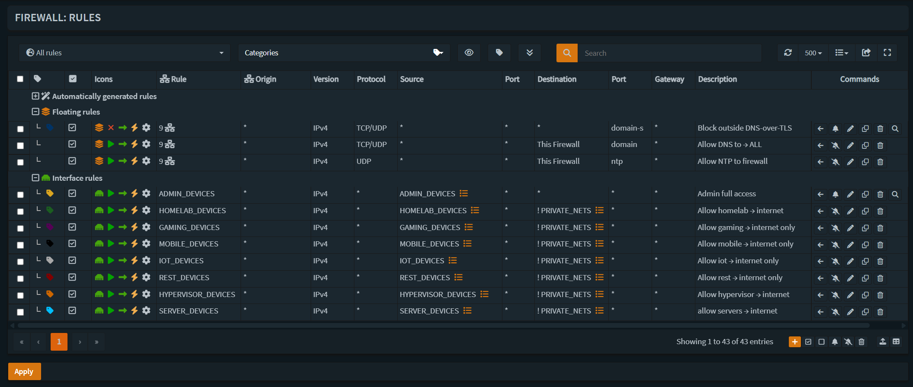
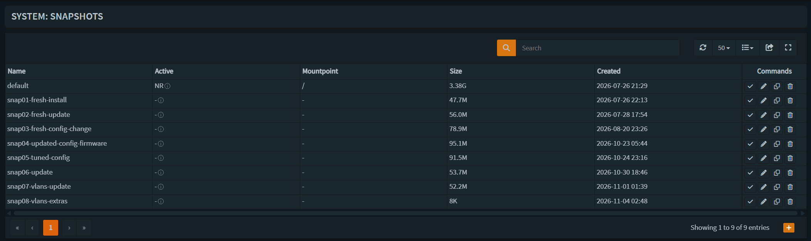

# Home network: OPNsense + VLANs

My home lab network, which I built and maintain myself. I'm studying to become a DBA, and this lab is where I practice the infrastructure around databases: networking, firewalling, Linux and virtualization.

> **Sanitized:** [`config-sanitized.xml`](config-sanitized.xml) is the real OPNsense backup with password hashes, keys, certificates, usernames and MAC addresses removed. The README is written by hand from the running setup.

---

## Topology

---

## Hardware

| Part     | Choice                                  | Notes                                  |
| -------- | --------------------------------------- | -------------------------------------- |
| Firewall | Dell OptiPlex 5090 SFF, i5-10500T, 16 GB | OPNsense on bare metal                 |
| WAN NIC  | Onboard Intel 1 Gbit                    |                                        |
| LAN NIC  | Intel I226-V 2.5 Gbit (M.2)             | Single 802.1Q trunk to the switch      |
| Switch   | TP-Link SG3210X-M2 (Omada, standalone)  | Layer 2 only. Routing is done by OPNsense |
| Hypervisor | Proxmox                               | Linux VMs, incl. Oracle Linux for DB practice |

---

## VLANs

Each VLAN is a `/24` (`10.0.<VLAN>.0/24`) with OPNsense as gateway on `.1`. Statics and reservations use `.11–.100`, the DHCP pool is `.101–.200`.

| VLAN | Name       | Purpose                         | Access                     |
| ---- | ---------- | ------------------------------- | -------------------------- |
| 10   | INFRA      | Firewall, switch management     | Reachable from ADMIN only  |
| 20   | ADMIN      | My admin PCs                    | Full access                |
| 30   | HYPERVISOR | Proxmox host                    | Internet only              |
| 40   | HOMELAB    | Lab VMs (Oracle Linux, logging) | Internet only              |
| 50   | GAMING     | Gaming PCs                      | Internet only              |
| 60   | MOBILE     | Phones, Wi-Fi AP                | Internet only              |
| 70   | IOT        | Smart devices                   | Internet only              |
| 80   | REST       | Unknown devices                 | Internet only              |
| 100  | SERVER     | Game server VMs (planned)       | Internet only              |

On the switch, port 8 is the tagged trunk to OPNsense and port 3 carries the Proxmox VLANs. Unused ports sit in **VLAN 999**, which goes nowhere, so plugging into a free port doesn't land you on a real network. VLAN 1 has no members. VLANs 70 and 80 exist on the firewall and will be added to the switch when devices need them.

---

## Firewall rules

Deny by default. Only the flows below are allowed:

1. **ADMIN → any:** allow, logged.
2. **All VLANs → firewall, DNS (53) and NTP (123):** allow.
3. **All VLANs → any, DNS-over-TLS (853):** block, logged. This forces clients to use the firewall's resolver.
4. **Every other VLAN → `! PRIVATE_NETS`:** allow. Internet yes, other VLANs no.

`PRIVATE_NETS` is an alias for RFC1918, CGNAT and link-local ranges. Anything not matched is dropped.

---

## Management

- Web GUI (HTTPS) and SSH listen on **INFRA only** (10.0.10.1). Admin PCs reach it through the ADMIN rule, and no other VLAN can.
- SSH on a non-standard port, **key-only**, root login disabled.
- Admin group is limited to the admin PCs' addresses. Root account disabled; I use a named account.
- 15-minute auto-logout, password-protected console.

---

## Services

- **DNS (Unbound):** DNSSEC, DNS-over-TLS upstream (Quad9), identity and version hidden. Local names for devices via host overrides (with PTR).
- **DHCP (Kea):** one subnet per VLAN, reservations for known devices.
- **Traffic shaping:** fq_codel on WAN up/down to keep latency low under load.
- **WAN:** private and bogon networks blocked. IPv6 disabled for now.
- **Logging:** remote syslog to a log VM in HOMELAB.

---

## IDS/IPS (Suricata)

Configured but **currently off** while I tune it.

| Policy                         | Action | Examples                                               |
| ------------------------------ | ------ | ------------------------------------------------------ |
| Confirmed malicious, low false positives | Drop   | abuse.ch, botnet C2, `drop`, exploit, phishing, worm  |
| Broad / behavioral             | Alert  | scan, malware, coinminer, tor, user agents             |

Inline (netmap) on WAN, hardware offloading disabled.

---

## Troubleshooting notes

**Intel I226-V on FreeBSD.** OPNsense worked as a Proxmox VM, but on bare metal the I226-V had driver issues (a known FreeBSD problem). It now runs bare metal on the I226-V.

**VLAN migration.** Moving from one flat /24 to VLANs taught me:
- OPNsense doesn't discover VLANs from the switch. Each one is created, assigned and given rules on the firewall.
- Devices with static IPs never show up in DHCP leases. The ARP table is where you see them.
- Change rules **before** changing listen interfaces, or you lock yourself out.

---

## Snapshots and rollback

OPNsense runs on ZFS, so I take a **boot environment snapshot** before every larger change (fresh install, updates, config tuning, the VLAN migration). If an update or change breaks something, I can boot back into the previous state in minutes.

Snapshots live on the same disk, so they protect against bad changes, not disk failure. That's why I also download the config backup to another machine.

---

## How I verify changes

- After each change: check the **ARP table** (is the device there?), **DHCP leases**, and test from a client with `nslookup` and `ping`.
- Firewall rules are tested from the VLAN they apply to, both allowed and blocked traffic, and blocks are confirmed in the firewall log.
- I download a **config backup before and after** larger changes, so I can roll back if needed.

---

## What this lab gives me as a future DBA

- **Networking:** VLANs, routing, firewall rules and DNS. This is what usually stands between an application and its database.
- **Linux:** Oracle Linux VMs with hardened SSH (key-only, fail2ban), used for database practice.
- **Security habits:** least privilege, separate management network, logging, and sanitizing before publishing.
- **Documentation:** writing down decisions, limitations and changes so someone else can follow them.

---

## Known limitations

- **No isolation inside a VLAN.** Devices in the same VLAN talk through the switch, not the firewall, so the firewall can't stop that traffic.
- **Plain DNS bypass.** Clients can still use an outside resolver on port 53. A per-VLAN redirect isn't in place yet.
- **DNS blocklist** is enabled but no lists are selected.
- **INFRA** has no internet rule (e.g. no switch firmware updates from the switch itself).

---

## Roadmap

1. Force all DNS through the firewall (port 53 redirect per VLAN).
2. Select DNS blocklists, and re-enable IDS/IPS after tuning.
3. Game server VM in SERVER, with friends connecting over Tailscale or WireGuard.
4. Remote access VPN with its own subnet and rules.
5. 802.1X with FreeRADIUS (EAP-TLS), so devices land in the right VLAN automatically.
6. 5G backup WAN (multi-WAN).

---

## Changelog

| Date    | Change                                                                    |
| ------- | ------------------------------------------------------------------------- |
| 2026-10 | Repo created: flat network, firewall design, IDS policy                   |
| 2026-11 | Managed switch + 9 VLANs, management moved to INFRA, SSH key-only, local DNS names |
| 2026-11 | Sanitized config backup and topology diagram added |