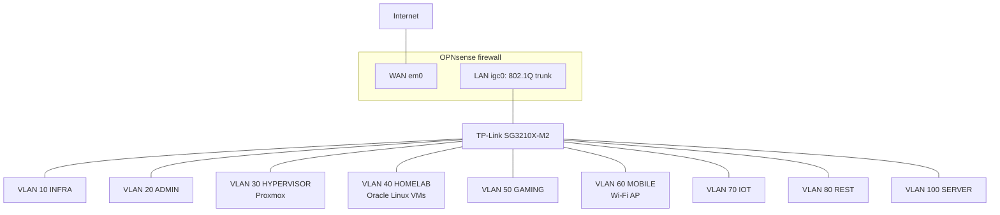
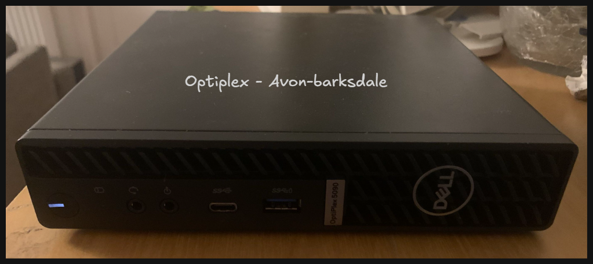
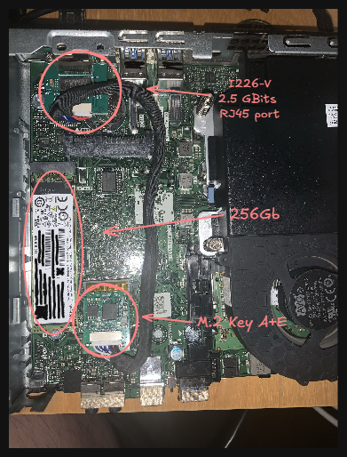
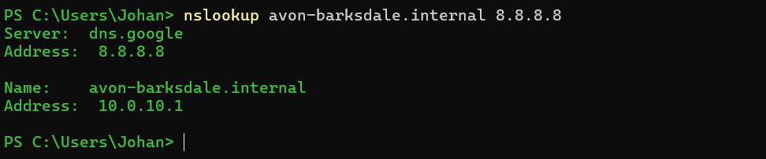

# Home network: OPNsense + VLANs

My home lab network, which I built and maintain myself. I'm studying to become a DBA, and this lab is where I practice the infrastructure around databases.

**At a glance:** OPNsense firewall, 9 VLANs over an 802.1Q trunk, deny-by-default rules, encrypted DNS, and Proxmox VMs running Oracle Linux. **Skills:** networking, firewalling, Linux, virtualization, documentation.

> **Sanitized:** [`config/config-sanitized.xml`](config/config-sanitized.xml) is the real OPNsense backup with password hashes, keys, certificates, usernames and MAC addresses removed. The README is written by hand from the running setup.

---

## Topology

---

## Hardware

| Part     | Choice                                  | Notes                                  |
| -------- | --------------------------------------- | -------------------------------------- |
| Firewall | Dell OptiPlex 5090 SFF, i5-10500T, 16 GB | OPNsense on bare metal                 |
| WAN NIC  | Onboard Intel 1 Gbit                    |                                        |
| LAN NIC  | Intel I226-V 2.5 Gbit (M.2)             | Single 802.1Q trunk to the switch      |
| Switch   | TP-Link SG3210X-M2 (Omada, standalone)  | Layer 2 only. Routing is done by OPNsense |
| Hypervisor | Proxmox                               | Linux VMs, incl. Oracle Linux for DB practice |
| LAN party switch | TP-Link TL-SG108E (older unit, reused) | Connected to an untagged VLAN 50 port on the main switch, so every port on it lands in GAMING. Friends plug in for LAN gaming without reaching the rest of the network |

📷 Show hardware photos

  
  

---

## VLANs

Each VLAN is a `/24` (`10.0.<VLAN>.0/24`) with OPNsense as gateway on `.1`. Statics and reservations use `.11–.100`, the DHCP pool is `.101–.200`.

| VLAN | Name       | Purpose                         | Access                     |
| ---- | ---------- | ------------------------------- | -------------------------- |
| 10   | INFRA      | Firewall, switch management     | Reachable from ADMIN only  |
| 20   | ADMIN      | My admin PCs                    | Full access (all VLANs + internet) |
| 30   | HYPERVISOR | Proxmox host                    | Internet only              |
| 40   | HOMELAB    | Lab VMs (Oracle Linux, logging) | Internet only              |
| 50   | GAMING     | Gaming PCs                      | Internet only              |
| 60   | MOBILE     | Phones, Wi-Fi AP                | Internet only              |
| 70   | IOT        | Smart devices                   | Internet only              |
| 80   | REST       | Unknown devices                 | Internet only              |
| 100  | SERVER     | Game server VMs (planned)       | Internet only              |

On the switch, port 8 is the tagged trunk to OPNsense and port 3 carries the Proxmox VLANs. Unused ports sit in **VLAN 999**, which goes nowhere, so plugging into a free port doesn't land you on a real network. VLAN 1 has no members. VLANs 70 and 80 exist on the firewall and will be added to the switch when devices need them.

---

## Firewall rules

Deny by default. Only the flows below are allowed:

1. **ADMIN → any:** allow, logged. Deliberate: admin PCs manage everything.
2. **All VLANs → firewall, DNS (53) and NTP (123):** allow.
3. **Every other VLAN → `! PRIVATE_NETS`:** allow. Internet yes, other VLANs no.

On top of that, two rules make sure every client uses the firewall's resolver:

- **Outside DNS (53) is redirected:** a NAT rule per VLAN sends any query for an outside resolver (e.g. `8.8.8.8`) to Unbound on the firewall. The client doesn't notice.
- **DNS-over-TLS (853) is blocked, logged:** encrypted DNS to outside resolvers is dropped, so clients fall back to plain DNS, which then gets redirected.

`PRIVATE_NETS` is an alias for RFC1918, CGNAT and link-local ranges. Anything not matched is dropped.

---

## Management

- Web GUI (HTTPS) and SSH listen on **INFRA only** (10.0.10.1). Admin PCs reach it through the ADMIN rule, and no other VLAN can.
- SSH on a non-standard port, **key-only**, root login disabled.
- Admin group is limited to the admin PCs' addresses. Root account disabled; I use a named account.
- 15-minute auto-logout, password-protected console.

---

## Services

- **DNS (Unbound):** DNSSEC validation, and all upstream queries go out encrypted with **DNS-over-TLS** to Quad9, so my ISP can't read or tamper with them. Identity and version hidden. Local names for devices via host overrides (with PTR).
- **DNS blocklist:** Steven Black's unified hosts list (ads and malware domains). Because all DNS is forced through the firewall, no device can bypass it with its own resolver.
- **DHCP (Kea):** one subnet per VLAN, reservations for known devices.
- **Traffic shaping:** fq_codel on WAN up/down to keep latency low under load.
- **WAN:** private and bogon networks blocked. IPv6 disabled for now.
- **Logging:** remote syslog to a log VM in HOMELAB.

---

## IDS/IPS (Suricata)

Configured but **currently off**: enabling it on bare metal caused a lockout (see [Troubleshooting notes](#troubleshooting-notes)).

| Policy                         | Action | Examples                                               |
| ------------------------------ | ------ | ------------------------------------------------------ |
| Confirmed malicious, low false positives | Drop   | abuse.ch, botnet C2, `drop`, exploit, phishing, worm  |
| Broad / behavioral             | Alert  | scan, malware, coinminer, tor, user agents             |

Inline (netmap) on WAN, hardware offloading disabled.

---

## How I built it

I designed and tested the setup in a **Proxmox VM** first, then moved it to bare metal.

**What I did on my own:**
- Firewall design: deny by default, one rule set per VLAN, aliases and categories.
- Unbound DNS with DNSSEC.
- DHCP reservations and local DNS names, with a naming convention (`firstname-lastname.internal`) so every device is easy to identify.

**Where I had help:**
- **802.1Q VLANs and trunking** between OPNsense and the switch.
- **Forcing DNS through the firewall:** blocking DNS-over-TLS (port 853) and redirecting plain DNS (port 53) with a NAT rule. Both were techniques I didn't know.
- **Troubleshooting** why VLANs other than ADMIN had no internet after the migration.

I used an AI assistant (Claude) as support during the migration, mainly to plan the order of changes so I wouldn't lose connectivity.

**What I'd do differently:** finish tuning everything in the VM before migrating. Several fixes happened on the live network that could have been solved in testing first.

---

## Troubleshooting notes

**IDS/IPS lockout on bare metal (open issue).** Suricata in inline IPS mode ran fine while I tuned it in a Proxmox VM. On bare metal, enabling it cut off both SSH and the web GUI, and only a hard reset brought the firewall back. Searching suggested the Intel I226-V or netmap on FreeBSD, but I haven't confirmed the cause. IDS/IPS stays off until I can test it properly. To get evidence next time, I've added remote syslog to another machine, so the logs survive a lockout.

**DNS redirect that never matched.** My first "Force DNS to firewall" NAT rule sat on the trunk interface, which has no IP and carries only tagged VLAN traffic, so it never caught anything. I only found it when a test query to `8.8.8.8` was answered by Google instead of my firewall. The fix was to move the rule to the VLAN interfaces, with source *any* and destination *not This Firewall*. Lesson: a rule that looks right in the list can still do nothing, so test it from a client.

**VLAN migration.** Moving from one flat /24 to VLANs taught me:
- OPNsense doesn't discover VLANs from the switch. Each one is created, assigned and given rules on the firewall.
- Devices with static IPs never show up in DHCP leases. The ARP table is where you see them.
- Change rules **before** changing listen interfaces, or you lock yourself out.

---

## Snapshots and rollback

OPNsense runs on ZFS, so I take a **boot environment snapshot** before every larger change (fresh install, updates, config tuning, the VLAN migration). If an update or change breaks something, I can boot back into the previous state in minutes.

Snapshots live on the same disk, so they protect against bad changes, not disk failure. That's why I also download the config backup to another machine.

---

## How I verify changes

- After each change: check the **ARP table** (is the device there?), **DHCP leases**, and test from a client with `nslookup` and `ping`.
- Firewall rules are tested from the VLAN they apply to, both allowed and blocked traffic, and blocks are confirmed in the firewall log.
- I download a **config backup before and after** larger changes, so I can roll back if needed.
- **DNS redirect test:** `nslookup avon-barksdale.internal 8.8.8.8`. Google can't know a local `.internal` name, so getting the firewall's IP back proves the query was silently answered by Unbound.

*Asking Google (8.8.8.8) for a local `.internal` name still returns the firewall's IP: the query was silently redirected to Unbound.*

---

## What this lab gives me as a future DBA

- **Networking:** VLANs, routing, firewall rules and DNS. This is what usually stands between an application and its database.
- **Linux:** Oracle Linux VMs with hardened SSH (key-only, fail2ban), used for database practice.
- **Security habits:** least privilege, separate management network, logging, and sanitizing before publishing.
- **Documentation:** writing down decisions, limitations and changes so someone else can follow them.

---

## Known limitations

- **No isolation inside a VLAN.** Devices in the same VLAN talk through the switch, not the firewall, so the firewall can't stop that traffic.
- **DNS-over-HTTPS isn't blocked.** DoH runs on port 443 like normal web traffic, so a client with DoH built in (e.g. a browser) can still bypass the firewall's resolver.
- **INFRA has no internet access, on purpose.** Switch firmware is downloaded manually, checked against the vendor's SHA-256 checksum, and then installed. It's more work, but nothing unverified runs on the management network.

---

## Roadmap

1. Re-enable IDS/IPS after finding the cause of the lockout, and add a dedicated threat blocklist (e.g. abuse.ch URLhaus).
2. Game server VM in SERVER, with friends connecting over Tailscale or WireGuard.
3. Remote access VPN with its own subnet and rules.
4. 802.1X with FreeRADIUS (EAP-TLS), so devices land in the right VLAN automatically.
5. 5G backup WAN (multi-WAN).

---

## Feedback

Suggestions and improvements are welcome. If you spot a mistake or a better way to do something, feel free to open an issue.

---

## Changelog

| Date    | Change                                                                    |
| ------- | ------------------------------------------------------------------------- |
| 2026-10 | Repo created: flat network, firewall design, IDS policy                   |
| 2026-11 | Managed switch + 9 VLANs, management moved to INFRA, SSH key-only, local DNS names |
| 2026-11 | Sanitized config backup and topology diagram added                        |
| 2026-11 | All DNS forced through the firewall: port 53 redirect per VLAN to Unbound. Replaced a broken NAT rule that sat on the trunk and never matched |
| 2026-11 | README corrected: DNS blocklist (Steven Black) documented as active, limitations and roadmap updated |